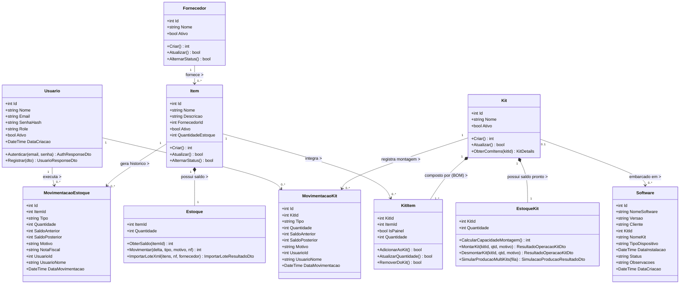
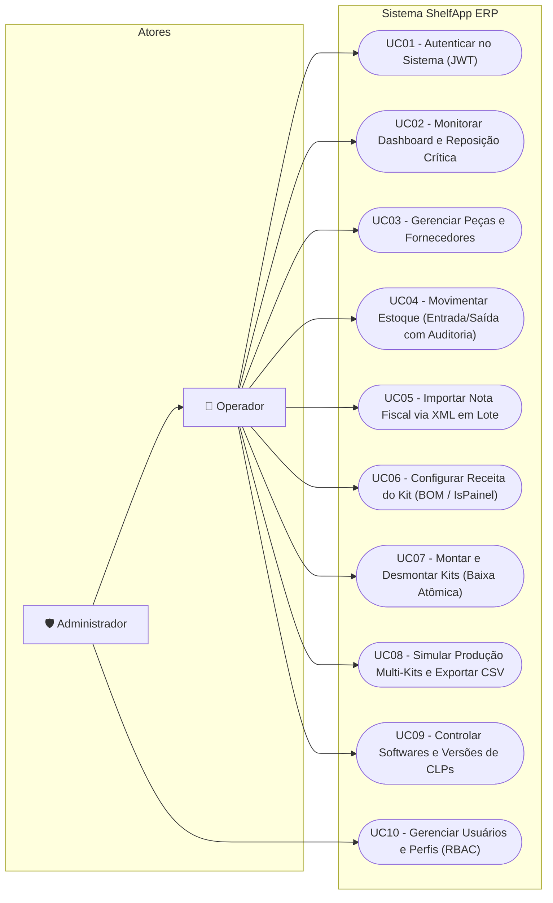
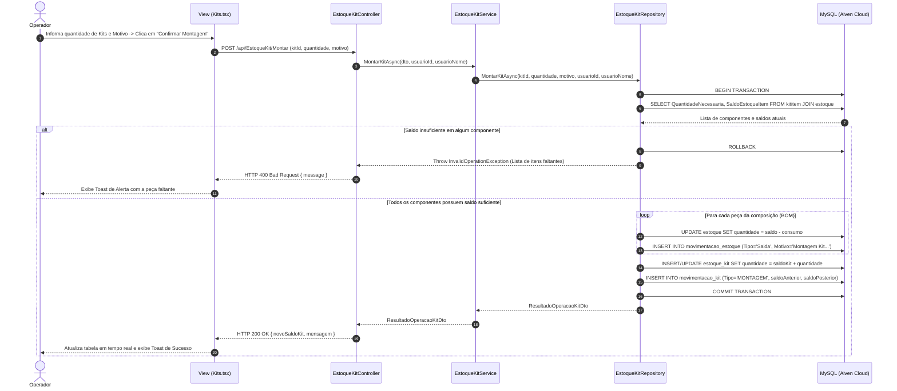
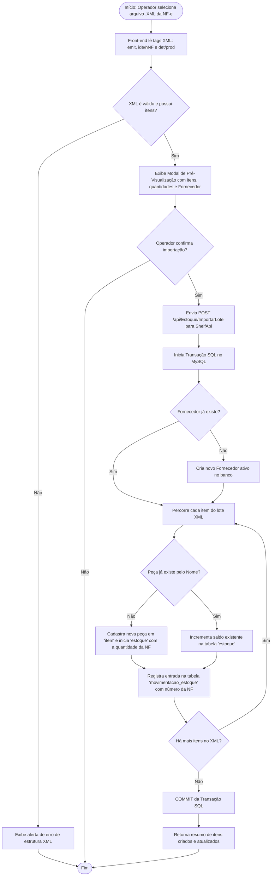

# 📐 Situação-Problema 1 — Modelagem da Solução em UML

**Projeto:** ShelfApp ERP & ShelfApi  
**Autor:** Eduardo Marcelo Pacheco Maticola (RGM: 34652671)  

Conforme abordado no material teórico da disciplina, a **Unified Modeling Language (UML)** fornece os artefatos estruturais e comportamentais que conectam os requisitos de negócio à implementação em código e ao modelo relacional do banco de dados.

---

## 1. Diagrama de Classes de Domínio e Persistência (Estrutural)

Cada classe abaixo foi modelada com seu **Nome** (substantivo representativo do domínio), **Descrição** em linguagem natural, **Atributos** tipados e **Métodos/Operações** que refletem o comportamento no negócio:

---

## 2. Diagrama de Casos de Uso (Comportamental)

Representa as interações dos atores (**Operador de Almoxarifado/Produção** e **Administrador**) com os módulos do sistema:

---

## 3. Diagrama de Sequência — Montagem Atômica de Kit (Comportamental)

Demonstra o fluxo de mensagens entre as camadas **View (React)**, **Controller**, **Service**, **Repository** e **Banco de Dados MySQL** durante a operação crítica de montagem de um kit:

---

## 4. Diagrama de Atividades — Importação de Nota Fiscal XML (Comportamental)

