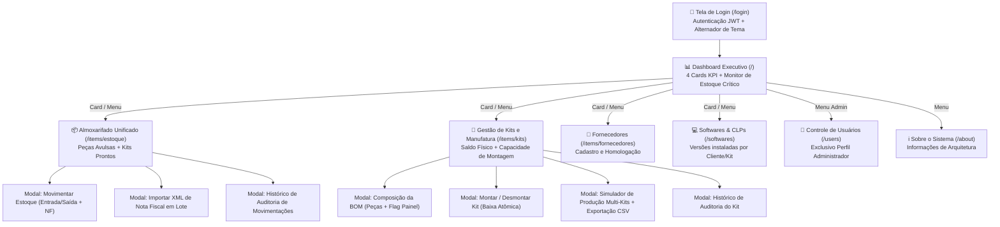

# 🎨 Situação-Problema 1 — Projeto de Interface Humano-Computador (IHC) e UX

**Projeto:** ShelfApp ERP  
**Autor:** Eduardo Marcelo Pacheco Maticola (RGM: 34652671)  

De acordo com os referenciais teóricos de **Don Norman** e **Usability.gov (2020)** apresentados no material da disciplina, uma boa Interface Humano-Computador (IHC) torna a comunicação entre o usuário e o sistema clara, previsível, recuperável e eficiente.

---

## 1. Aplicação dos 7 Princípios de IHC no ShelfApp

| Princípio Teórico (Material da Disciplina) | Como foi Implementado na Prática no ShelfApp |
| :--- | :--- |
| **1. Deve ser clara** | Uso de indicadores semânticos por cores padronizadas em todo o sistema: **Verde** (`badge-green` = Estoque Normal > 10 un), **Âmbar** (`badge-amber` = Baixo Estoque de 1 a 10 un) e **Vermelho** (`badge-red` = Estoque Zerado 0 un). |
| **2. Deve ser consistente** | Todas as páginas seguem exatamente o mesmo padrão estrutural: Cabeçalho com título e ações primárias à direita, Barra de Filtros/Pesquisa logo abaixo, Tabela Ordenável com Paginação e Modais padronizados. |
| **3. Deve ser simples (Divulgação Progressiva)** | A tabela principal de Kits exibe apenas os indicadores essenciais (ID, Nome, Status, Saldo Físico e Capacidade de Montagem). Detalhes complexos como a lista de 40 peças da BOM ou o histórico de auditoria ficam recolhidos em janelas modais acionadas sob demanda. |
| **4. Deve ser controlada pelo usuário** | Nenhum filtro ou ação destrutiva ocorre sem comando explícito. O usuário controla a ordenação de qualquer coluna (`SortableTh`), a quantidade de itens por página (5, 10, 20, 50) e o tema visual (**Modo Claro / Modo Escuro**). |
| **5. Deve ser direta (Causa e Efeito visíveis)** | No modal de Movimentação de Estoque, ao digitar a quantidade, o sistema exibe instantaneamente um *preview* matemático: `Saldo Atual: 10 un ➔ Novo Saldo: 60 un` antes mesmo de o usuário clicar em salvar. |
| **6. Deve ser empática e recuperável/reversível** | Ações críticas possuem confirmação (`ConfirmModal`). Além disso, caso um operador monte um kit por engano, a função **Desmontar Kit** reverte integralmente a operação, devolvendo 100% das peças ao almoxarifado. Peças e kits com histórico não são apagados acidentalmente: o sistema bloqueia a exclusão e orienta a **Inativação**. |
| **7. Deve dar uma resposta (Feedback imediato)** | Toda operação exibe estados de carregamento (`spinner`), desabilita botões durante o envio para evitar cliques duplos e dispara notificações flutuantes (*Toasts*) de sucesso ou erro com mensagens em linguagem natural. |

---

## 2. Mapeamento dos Elementos de Interface (UI Elements)

Seguindo a classificação técnica do material da disciplina (*Usability.gov*):

1. **Controles de Entrada (*Input Controls*):**
   * Campos de texto com ícones contextuais (busca instantânea, e-mail, senha com botão de revelar/ocultar);
   * Seletores segmentados (*pills*) para alternar rapidamente categorias (`[Todos]`, `[Peças]`, `[Kits]`) e foco do simulador (`[Todos]`, `[Apenas Painel]`, `[Peças Gerais]`);
   * Caixas de seleção (*checkbox* `IsPainel` para classificar componentes exclusivos do quadro elétrico);
   * Upload de arquivos com suporte a seleção de `.xml` para importação de Notas Fiscais.
2. **Componentes de Navegação (*Navigation Components*):**
   * Menu Lateral fixo (*Sidebar*) com destaque visual da rota ativa;
   * Trilha de navegação (*Breadcrumbs*) na barra superior (*Topbar*);
   * Cards de KPI clicáveis no Dashboard que redirecionam para o Almoxarifado já aplicando o filtro correspondente (`?status=zerado` ou `?status=baixo`);
   * Componente de Paginação (`Pagination.tsx`) e Cabeçalhos de Tabela Ordenáveis (`SortableTh.tsx`).
3. **Componentes Informativos (*Informational Components*):**
   * *Tooltips* (`title`) em todos os botões de ação por ícone;
   * *Toasts* (`ToastContainer.tsx`) para feedback de operações;
   * Janelas Modais (`Modal.tsx`, `ConfirmModal.tsx`, `SimuladorMontagemModal.tsx`, `ImportarXmlModal.tsx`);
   * Estados vazios informativos (*Empty States*) e banners de status (*"Estoque 100% Regularizado"*).

---

## 3. Mapa Conceitual de Navegação das Telas

---

## 4. Catálogo de Mensagens de Erro e Validação amigáveis na IHC

O sistema foi projetado para nunca expor *stack traces* técnicos ao usuário final, traduzindo restrições de negócio em orientações claras:

* **Tentativa de Saída Maior que o Saldo:** *"Saldo insuficiente. O item possui apenas X unidades em estoque."* (O botão de confirmação é bloqueado preventivamente na própria interface).
* **Tentativa de Montar Kit sem Componentes Suficientes:** *"Saldo insuficiente de componentes para montar X un do kit 'Y': [Lista detalhada de cada peça faltante, saldo atual e necessário]."*
* **Tentativa de Excluir Fornecedor ou Peça em Uso:** *"Não é possível excluir o item #X pois ele possui histórico de movimentação ou está vinculado a kits. Utilize a opção Inativar."*
* **Tentativa de Adicionar Peça Duplicada na Mesma Categoria do Kit:** *"Este item já está cadastrado na composição deste kit."*
* **Tentativa de Autoexclusão de Administrador:** *"Você não pode excluir o seu próprio usuário logado."*
