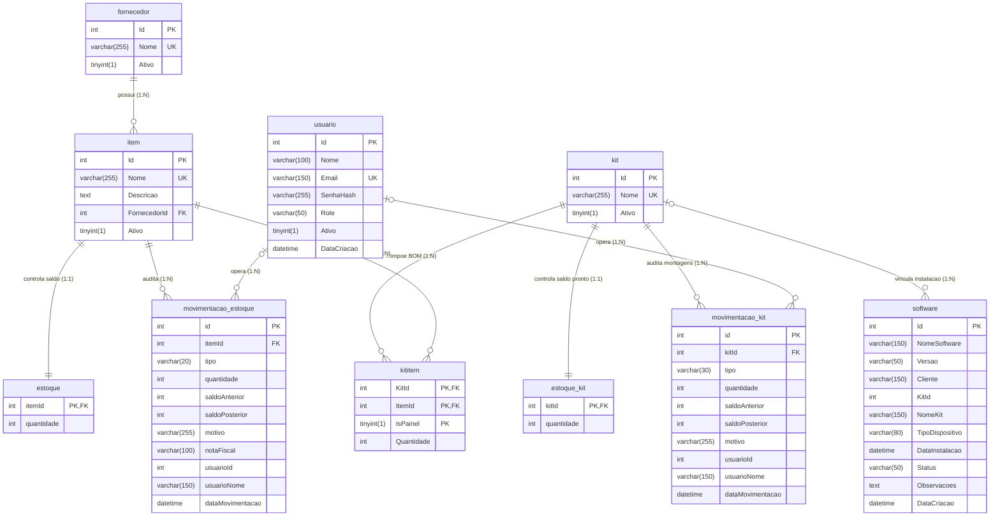

# 🗄️ Situação-Problema 1 — Projeto de Banco de Dados e Dicionário de Dados

**Projeto:** ShelfApp ERP & ShelfApi  
**SGBD Escolhido:** MySQL 8.0 (Hospedado em nuvem na Aiven Cloud com suporte a InnoDB, integridade referencial ACID e codificação `utf8mb4`)  
**Autor:** Eduardo Marcelo Pacheco Maticola (RGM: 34652671)  

---

## 1. Projeto Conceitual e Lógico Normalizado (DER)

O modelo relacional foi projetado respeitando rigorosamente as três Formas Normais (**1FN, 2FN e 3FN**):
* **1ª Forma Normal (1FN):** Todos os atributos são atômicos (não existem grupos repetidos ou listas multivaloradas; a relação N:N entre `kit` e `item` foi decomposta na entidade associativa `kititem`).
* **2ª Forma Normal (2FN):** Na tabela associativa `kititem` (chave primária composta `KitId, ItemId, IsPainel`), o atributo não-chave `Quantidade` depende da chave composta inteira, sem dependências parciais.
* **3ª Forma Normal (3FN):** Não há dependências transitivas nos cadastros mestre (`item` armazena apenas `FornecedorId`, sem duplicar o nome do fornecedor; os históricos `movimentacao_estoque` e `movimentacao_kit` preservam o instantâneo de auditoria da operação).

### Diagrama Entidade-Relacionamento (DER)



---

## 2. Dicionário de Dados Completo

### 2.1 Tabela `fornecedor`
Armazena as empresas parceiras e fabricantes homologados de insumos e componentes elétricos/mecânicos.

| Atributo / Campo | Tipo Físico (MySQL) | Domínio de Valor | Nulo? | Restrição / Chave | Descrição Funcional |
| :--- | :--- | :--- | :---: | :--- | :--- |
| `Id` | `INT AUTO_INCREMENT` | Inteiros positivos $\ge 1$ | Não | `PRIMARY KEY` | Identificador único do fornecedor. |
| `Nome` | `VARCHAR(255)` | Razão social ou nome fantasia | Não | `UNIQUE KEY` | Nome comercial único do parceiro (ex: Schneider, Phoenix). |
| `Ativo` | `TINYINT(1)` | `0` (Inativo) ou `1` (Ativo) | Não | `DEFAULT 1` | Define se o fornecedor está ativo para novos vínculos. |

---

### 2.2 Tabela `item`
Catálogo mestre de todas as peças, componentes elétricos e insumos do almoxarifado.

| Atributo / Campo | Tipo Físico (MySQL) | Domínio de Valor | Nulo? | Restrição / Chave | Descrição Funcional |
| :--- | :--- | :--- | :---: | :--- | :--- |
| `Id` | `INT AUTO_INCREMENT` | Inteiros positivos $\ge 1$ | Não | `PRIMARY KEY` | Código identificador único da peça (SKU interno). |
| `Nome` | `VARCHAR(255)` | Código comercial/part number | Não | `UNIQUE KEY` | Nome ou código único da peça (ex: `LC1D32B7`, `PT 2.5`). |
| `Descricao` | `TEXT` | Texto descritivo livre | Sim | `NULL` | Especificações técnicas adicionais ou referência XML. |
| `FornecedorId` | `INT` | ID válido de `fornecedor` | Sim | `FOREIGN KEY` | Referência ao fornecedor que fabrica/distribui o item. |
| `Ativo` | `TINYINT(1)` | `0` (Inativo) ou `1` (Ativo) | Não | `DEFAULT 1` | Indica se o item está ativo no catálogo operacional. |

---

### 2.3 Tabela `estoque`
Controla o saldo físico atual disponível de cada peça avulsa no almoxarifado.

| Atributo / Campo | Tipo Físico (MySQL) | Domínio de Valor | Nulo? | Restrição / Chave | Descrição Funcional |
| :--- | :--- | :--- | :---: | :--- | :--- |
| `itemId` | `INT` | ID válido da tabela `item` | Não | `PK`, `FK CASCADE` | Identificador da peça cujo saldo está sendo controlado. |
| `quantidade` | `INT` | Inteiros não-negativos ($0$ a $10^8$) | Não | `DEFAULT 0` | Quantidade física atual disponível na prateleira. |

---

### 2.4 Tabela `movimentacao_estoque`
Livro-razão (log imutável de auditoria) de todas as entradas e saídas de peças avulsas.

| Atributo / Campo | Tipo Físico (MySQL) | Domínio de Valor | Nulo? | Restrição / Chave | Descrição Funcional |
| :--- | :--- | :--- | :---: | :--- | :--- |
| `id` | `INT AUTO_INCREMENT` | Inteiros positivos $\ge 1$ | Não | `PRIMARY KEY` | Identificador sequencial do registro de auditoria. |
| `itemId` | `INT` | ID válido da tabela `item` | Não | `FK`, `INDEX` | Peça movimentada na operação. |
| `tipo` | `VARCHAR(20)` | `'Entrada'` ou `'Saida'` | Não | `NOT NULL` | Natureza da movimentação de estoque. |
| `quantidade` | `INT` | Inteiros positivos $\ge 1$ | Não | `NOT NULL` | Quantidade movimentada na transação. |
| `saldoAnterior` | `INT` | Inteiros $\ge 0$ | Não | `NOT NULL` | Saldo da peça imediatamente antes da operação. |
| `saldoPosterior` | `INT` | Inteiros $\ge 0$ | Não | `NOT NULL` | Saldo resultante após a operação. |
| `motivo` | `VARCHAR(255)` | Justificativa operacional | Sim | `NULL` | Explicação do motivo da entrada, saída ou montagem. |
| `notaFiscal` | `VARCHAR(100)` | Número da NF-e | Sim | `NULL` | Documento fiscal vinculado à entrada ou importação XML. |
| `usuarioId` | `INT` | ID do usuário operador | Sim | `NULL` | Identificador do colaborador que realizou a ação. |
| `usuarioNome` | `VARCHAR(150)` | Nome do operador | Não | `DEFAULT 'Sistema'` | Nome gravado para rastreabilidade histórica. |
| `dataMovimentacao` | `DATETIME` | Data/hora válida UTC/Local | Não | `DEFAULT CURRENT_TIMESTAMP` | Carimbo de tempo exato da transação. |

---

### 2.5 Tabela `kit`
Cadastro mestre dos modelos de kits industriais e painéis produzidos pela fábrica.

| Atributo / Campo | Tipo Físico (MySQL) | Domínio de Valor | Nulo? | Restrição / Chave | Descrição Funcional |
| :--- | :--- | :--- | :---: | :--- | :--- |
| `Id` | `INT AUTO_INCREMENT` | Inteiros positivos $\ge 1$ | Não | `PRIMARY KEY` | Identificador único do modelo de kit. |
| `Nome` | `VARCHAR(255)` | Nome do modelo de kit | Não | `UNIQUE KEY` | Nome comercial/técnico do kit (ex: `AB200 INV 380V`). |
| `Ativo` | `TINYINT(1)` | `0` (Inativo) ou `1` (Ativo) | Não | `DEFAULT 1` | Status de disponibilidade do kit na linha de produção. |

---

### 2.6 Tabela `kititem`
Tabela associativa que representa a Ficha Técnica / Lista de Materiais (*BOM — Bill of Materials*) de cada kit.

| Atributo / Campo | Tipo Físico (MySQL) | Domínio de Valor | Nulo? | Restrição / Chave | Descrição Funcional |
| :--- | :--- | :--- | :---: | :--- | :--- |
| `KitId` | `INT` | ID válido de `kit` | Não | `PK Composta`, `FK` | Kit ao qual o componente pertence. |
| `ItemId` | `INT` | ID válido de `item` | Não | `PK Composta`, `FK` | Peça integrante da receita de montagem. |
| `IsPainel` | `TINYINT(1)` | `1` (Painel Elétrico) ou `0` (Geral) | Não | `PK Composta` | Segrega se o componente é montado na placa do painel ou avulso. |
| `Quantidade` | `INT` | Inteiros positivos $\ge 1$ | Não | `NOT NULL` | Quantidade exigida da peça para produzir 1 unidade do kit. |

---

### 2.7 Tabela `estoque_kit`
Controla o saldo físico de kits acabados (já montados e prontos para expedição).

| Atributo / Campo | Tipo Físico (MySQL) | Domínio de Valor | Nulo? | Restrição / Chave | Descrição Funcional |
| :--- | :--- | :--- | :---: | :--- | :--- |
| `kitId` | `INT` | ID válido de `kit` | Não | `PK`, `FK CASCADE` | Modelo de kit controlado. |
| `quantidade` | `INT` | Inteiros não-negativos $\ge 0$ | Não | `DEFAULT 0` | Quantidade de conjuntos prontos em prateleira. |

---

### 2.8 Tabela `movimentacao_kit`
Histórico de auditoria de todas as montagens, desmontagens e expedições de kits.

| Atributo / Campo | Tipo Físico (MySQL) | Domínio de Valor | Nulo? | Restrição / Chave | Descrição Funcional |
| :--- | :--- | :--- | :---: | :--- | :--- |
| `id` | `INT AUTO_INCREMENT` | Inteiros positivos $\ge 1$ | Não | `PRIMARY KEY` | Identificador único do log do kit. |
| `kitId` | `INT` | ID válido de `kit` | Não | `FK`, `INDEX` | Kit movimentado. |
| `tipo` | `VARCHAR(30)` | `'MONTAGEM'`, `'DESMONTAGEM'`, `'ENTRADA'`, `'SAIDA'` | Não | `NOT NULL` | Tipo de operação fabril executada. |
| `quantidade` | `INT` | Inteiros positivos $\ge 1$ | Não | `NOT NULL` | Quantidade de kits produzidos, desmontados ou expedidos. |
| `saldoAnterior` | `INT` | Inteiros $\ge 0$ | Não | `NOT NULL` | Saldo físico de kits prontos antes da operação. |
| `saldoPosterior` | `INT` | Inteiros $\ge 0$ | Não | `NOT NULL` | Saldo físico de kits prontos após a operação. |
| `motivo` | `VARCHAR(255)` | Texto descritivo | Sim | `NULL` | Ordem de Produção, pedido ou justificativa. |
| `usuarioId` | `INT` | ID do usuário | Sim | `NULL` | ID do operador autenticado. |
| `usuarioNome` | `VARCHAR(150)` | Nome do operador | Não | `DEFAULT 'Sistema'` | Nome do operador responsável. |
| `dataMovimentacao` | `DATETIME` | Data/hora | Não | `DEFAULT CURRENT_TIMESTAMP` | Momento exato do registro. |

---

### 2.9 Tabela `software`
Prontuário técnico de softwares, firmwares e versões de CLPs/IHMs instalados em campo.

| Atributo / Campo | Tipo Físico (MySQL) | Domínio de Valor | Nulo? | Restrição / Chave | Descrição Funcional |
| :--- | :--- | :--- | :---: | :--- | :--- |
| `Id` | `INT AUTO_INCREMENT` | Inteiros positivos $\ge 1$ | Não | `PRIMARY KEY` | Identificador do registro de instalação. |
| `NomeSoftware` | `VARCHAR(150)` | Nome do programa/firmware | Não | `NOT NULL` | Nome do software instalado. |
| `Versao` | `VARCHAR(50)` | SemVer (ex: `v1.2.0`) | Não | `NOT NULL` | Versão homologada gravada no equipamento. |
| `Cliente` | `VARCHAR(150)` | Nome do cliente comprador | Não | `NOT NULL` | Cliente onde o equipamento opera. |
| `KitId` | `INT` | ID de `kit` ou `NULL` | Sim | `NULL` | Referência opcional ao kit do catálogo. |
| `NomeKit` | `VARCHAR(150)` | Nome do kit ou customizado | Sim | `NULL` | Nome descritivo do conjunto instalado. |
| `TipoDispositivo` | `VARCHAR(80)` | `'CLP'`, `'IHM'`, `'Inversor'`, `'Outro'` | Não | `DEFAULT 'CLP'` | Categoria do hardware programado. |
| `DataInstalacao` | `DATETIME` | Data válida | Não | `NOT NULL` | Data do comissionamento/instalação. |
| `Status` | `VARCHAR(50)` | `'Operacional'`, `'Em Testes'`, `'Descontinuado'` | Não | `DEFAULT 'Operacional'` | Estado atual da instalação. |
| `Observacoes` | `TEXT` | Texto livre | Sim | `NULL` | Notas técnicas de engenharia. |
| `DataCriacao` | `DATETIME` | Data/hora de registro | Não | `DEFAULT CURRENT_TIMESTAMP` | Data de criação no ERP. |

---

### 2.10 Tabela `usuario`
Credenciais e controle de acesso baseado em papéis (RBAC).

| Atributo / Campo | Tipo Físico (MySQL) | Domínio de Valor | Nulo? | Restrição / Chave | Descrição Funcional |
| :--- | :--- | :--- | :---: | :--- | :--- |
| `Id` | `INT AUTO_INCREMENT` | Inteiros positivos $\ge 1$ | Não | `PRIMARY KEY` | Identificador único do usuário. |
| `Nome` | `VARCHAR(100)` | Nome completo | Não | `NOT NULL` | Nome de exibição e auditoria. |
| `Email` | `VARCHAR(150)` | E-mail válido | Não | `UNIQUE KEY` | Login único do colaborador. |
| `SenhaHash` | `VARCHAR(255)` | Hash BCrypt (`$2a$11$...`) | Não | `NOT NULL` | Senha criptografada de mão única. |
| `Role` | `VARCHAR(50)` | `'Admin'` ou `'Operador'` | Não | `DEFAULT 'Operador'` | Papel de permissão no sistema. |
| `Ativo` | `TINYINT(1)` | `0` ou `1` | Não | `DEFAULT 1` | Indica se o acesso está habilitado. |
| `DataCriacao` | `DATETIME` | Data/hora | Não | `DEFAULT CURRENT_TIMESTAMP` | Data de cadastro da conta. |

---

## 3. Script do Projeto Físico (DDL SQL — MySQL 8.0)

```sql
CREATE DATABASE IF NOT EXISTS `defaultdb` DEFAULT CHARACTER SET utf8mb4 COLLATE utf8mb4_0900_ai_ci;
USE `defaultdb`;

CREATE TABLE `fornecedor` (
  `Id` int NOT NULL AUTO_INCREMENT,
  `Nome` varchar(255) NOT NULL,
  `Ativo` tinyint(1) NOT NULL DEFAULT '1',
  PRIMARY KEY (`Id`),
  UNIQUE KEY `Nome` (`Nome`)
) ENGINE=InnoDB DEFAULT CHARSET=utf8mb4 COLLATE=utf8mb4_0900_ai_ci;

CREATE TABLE `item` (
  `Id` int NOT NULL AUTO_INCREMENT,
  `Nome` varchar(255) NOT NULL,
  `Descricao` text,
  `FornecedorId` int DEFAULT NULL,
  `Ativo` tinyint(1) NOT NULL DEFAULT '1',
  PRIMARY KEY (`Id`),
  UNIQUE KEY `Nome` (`Nome`),
  KEY `FornecedorId` (`FornecedorId`),
  CONSTRAINT `item_ibfk_1` FOREIGN KEY (`FornecedorId`) REFERENCES `fornecedor` (`Id`)
) ENGINE=InnoDB DEFAULT CHARSET=utf8mb4 COLLATE=utf8mb4_0900_ai_ci;

CREATE TABLE `estoque` (
  `itemId` int NOT NULL,
  `quantidade` int NOT NULL DEFAULT '0',
  PRIMARY KEY (`itemId`),
  CONSTRAINT `estoque_ibfk_1` FOREIGN KEY (`itemId`) REFERENCES `item` (`Id`) ON DELETE CASCADE ON UPDATE CASCADE
) ENGINE=InnoDB DEFAULT CHARSET=utf8mb4 COLLATE=utf8mb4_0900_ai_ci;

CREATE TABLE `movimentacao_estoque` (
  `id` int NOT NULL AUTO_INCREMENT,
  `itemId` int NOT NULL,
  `tipo` varchar(20) NOT NULL,
  `quantidade` int NOT NULL,
  `saldoAnterior` int NOT NULL,
  `saldoPosterior` int NOT NULL,
  `motivo` varchar(255) DEFAULT NULL,
  `notaFiscal` varchar(100) DEFAULT NULL,
  `usuarioId` int DEFAULT NULL,
  `usuarioNome` varchar(150) NOT NULL DEFAULT 'Sistema',
  `dataMovimentacao` datetime NOT NULL DEFAULT CURRENT_TIMESTAMP,
  PRIMARY KEY (`id`),
  KEY `idx_mov_item` (`itemId`),
  KEY `idx_mov_data` (`dataMovimentacao`),
  CONSTRAINT `fk_mov_item` FOREIGN KEY (`itemId`) REFERENCES `item` (`Id`) ON DELETE CASCADE
) ENGINE=InnoDB DEFAULT CHARSET=utf8mb4 COLLATE=utf8mb4_0900_ai_ci;

CREATE TABLE `kit` (
  `Id` int NOT NULL AUTO_INCREMENT,
  `Nome` varchar(255) NOT NULL,
  `Ativo` tinyint(1) NOT NULL DEFAULT '1',
  PRIMARY KEY (`Id`),
  UNIQUE KEY `Nome` (`Nome`)
) ENGINE=InnoDB DEFAULT CHARSET=utf8mb4 COLLATE=utf8mb4_0900_ai_ci;

CREATE TABLE `kititem` (
  `KitId` int NOT NULL,
  `ItemId` int NOT NULL,
  `IsPainel` tinyint(1) NOT NULL,
  `Quantidade` int NOT NULL,
  PRIMARY KEY (`KitId`,`ItemId`,`IsPainel`),
  KEY `ItemId` (`ItemId`),
  CONSTRAINT `kititem_ibfk_1` FOREIGN KEY (`KitId`) REFERENCES `kit` (`Id`),
  CONSTRAINT `kititem_ibfk_2` FOREIGN KEY (`ItemId`) REFERENCES `item` (`Id`)
) ENGINE=InnoDB DEFAULT CHARSET=utf8mb4 COLLATE=utf8mb4_0900_ai_ci;

CREATE TABLE `estoque_kit` (
  `kitId` int NOT NULL,
  `quantidade` int NOT NULL DEFAULT '0',
  PRIMARY KEY (`kitId`),
  CONSTRAINT `fk_estoque_kit_kit` FOREIGN KEY (`kitId`) REFERENCES `kit` (`Id`) ON DELETE CASCADE
) ENGINE=InnoDB DEFAULT CHARSET=utf8mb4 COLLATE=utf8mb4_0900_ai_ci;

CREATE TABLE `movimentacao_kit` (
  `id` int NOT NULL AUTO_INCREMENT,
  `kitId` int NOT NULL,
  `tipo` varchar(30) NOT NULL,
  `quantidade` int NOT NULL,
  `saldoAnterior` int NOT NULL,
  `saldoPosterior` int NOT NULL,
  `motivo` varchar(255) DEFAULT NULL,
  `usuarioId` int DEFAULT NULL,
  `usuarioNome` varchar(150) NOT NULL DEFAULT 'Sistema',
  `dataMovimentacao` datetime NOT NULL DEFAULT CURRENT_TIMESTAMP,
  PRIMARY KEY (`id`),
  KEY `idx_kit_id` (`kitId`),
  KEY `idx_data_mov` (`dataMovimentacao`),
  CONSTRAINT `fk_mov_kit_kit` FOREIGN KEY (`kitId`) REFERENCES `kit` (`Id`) ON DELETE CASCADE
) ENGINE=InnoDB DEFAULT CHARSET=utf8mb4 COLLATE=utf8mb4_0900_ai_ci;

CREATE TABLE `software` (
  `Id` int NOT NULL AUTO_INCREMENT,
  `NomeSoftware` varchar(150) NOT NULL,
  `Versao` varchar(50) NOT NULL,
  `Cliente` varchar(150) NOT NULL,
  `KitId` int DEFAULT NULL,
  `NomeKit` varchar(150) DEFAULT NULL,
  `TipoDispositivo` varchar(80) NOT NULL DEFAULT 'CLP',
  `DataInstalacao` datetime NOT NULL,
  `Status` varchar(50) NOT NULL DEFAULT 'Operacional',
  `Observacoes` text,
  `DataCriacao` datetime NOT NULL DEFAULT CURRENT_TIMESTAMP,
  PRIMARY KEY (`Id`)
) ENGINE=InnoDB DEFAULT CHARSET=utf8mb4 COLLATE=utf8mb4_0900_ai_ci;

CREATE TABLE `usuario` (
  `Id` int NOT NULL AUTO_INCREMENT,
  `Nome` varchar(100) NOT NULL,
  `Email` varchar(150) NOT NULL,
  `SenhaHash` varchar(255) NOT NULL,
  `Role` varchar(50) NOT NULL DEFAULT 'Operador',
  `Ativo` tinyint(1) NOT NULL DEFAULT '1',
  `DataCriacao` datetime NOT NULL DEFAULT CURRENT_TIMESTAMP,
  PRIMARY KEY (`Id`),
  UNIQUE KEY `Email` (`Email`)
) ENGINE=InnoDB DEFAULT CHARSET=utf8mb4 COLLATE=utf8mb4_0900_ai_ci;
```
