# ⚙️ Situação-Problema 2 — Arquitetura MVC, Padrões de Projeto e Codificação

**Projeto:** ShelfApp ERP & ShelfApi  
**Autor:** Eduardo Marcelo Pacheco Maticola (RGM: 34652671)  

---

## 1. Adoção do Padrão Arquitetural MVC em Camadas

Conforme recomendado no material teórico da disciplina (Figura 2 — *Exemplo de MVC em aplicação web*), a solução foi desenvolvida separando rigorosamente as preocupações de **Model**, **View** e **Controller**, evoluída para o modelo contemporâneo de **API RESTful + SPA (Single Page Application)**:

```mermaid
flowchart LR
    User(["👤 Usuário (Navegador)"]) -->|Interação UI| View["🎨 VIEW (ShelfApp)<br/>React 19 + TypeScript + CSS"]
    View -->|Requisição HTTP REST / JSON| Router["🌐 ROUTER (ASP.NET Core)<br/>Roteamento & Middleware JWT"]
    Router --> Ctrl["🧠 CONTROLLER (ShelfApi)<br/>Validação de Entrada & Status HTTP"]
    Ctrl <-->|Regras de Negócio| Svc["⚙️ SERVICE LAYER<br/>Orquestração & Cálculos"]
    Svc <-->|Persistência Dapper| Repo["🗄️ MODEL / REPOSITORY<br/>Entidades, DTOs & SQL MySQL"]
    Repo <-->|SSL / TCP| DB[("🛢️ Banco de Dados MySQL 8<br/>Aiven Cloud")]
```

### Papel de Cada Camada no Projeto:
1. **Model (`ShelfApi/Models` e `ShelfApi/Repositories`):**
   * Representa as estruturas de dados centrais (`Item`, `Fornecedor`, `Kit`, `KitItem`, `Estoque`, `Software`, `Usuario`) e seus Objetos de Transferência de Dados (*DTOs*), além de encapsular o armazenamento, transações ACID e validações de integridade no MySQL via *Dapper Micro-ORM*.
2. **View (`ShelfApp/src/pages` e `ShelfApp/src/components`):**
   * Camada visual reativa construída com **HTML5, CSS3 Custom Properties e TypeScript (React 19)**. Monitora o estado dos dados, aplica filtros instantâneos, exibe modais e atualiza a tela sem recarregamento completo da página.
3. **Controller (`ShelfApi/Controllers` e `ShelfApi/Services`):**
   * Atua como o cérebro da comunicação HTTP: recebe as entradas do usuário, valida os modelos (`ModelState`), aciona a camada de Serviços (`Services`) e devolve respostas padronizadas em JSON com códigos semânticos (`200 OK`, `201 Created`, `400 Bad Request`, `401 Unauthorized`, `404 NotFound`).

---

## 2. Tecnologias e Stack de Desenvolvimento

| Camada | Tecnologia / Biblioteca | Justificativa Técnica |
| :--- | :--- | :--- |
| **Linguagem Back-end** | **C# / .NET 9.0** (`ASP.NET Core Web API`) | Linguagem fortemente tipada, multiplataforma e de altíssima performance recomendada na Situação-Problema 2. |
| **Acesso a Dados** | **Dapper 2.1.66** + `MySqlConnector 2.5.0` | Micro-ORM de baixo acoplamento que permite controle total sobre consultas SQL, `JOINs` analíticos e transações explícitas. |
| **Segurança e Auth** | **JWT Bearer** + `BCrypt.Net-Next 4.2.0` | Autenticação *stateless* via token assinado com `HMAC-SHA256` e hash criptográfico de senhas. |
| **Documentação API** | **Swagger / OpenAPI** (`Swashbuckle`) | Interface interativa em `/swagger` para inspeção e teste de todos os endpoints REST. |
| **Front-end Web** | **React 19 + TypeScript 5 + Vite 7** | Componentização modular, tipagem estrita em tempo de compilação e *build* otimizado. |
| **Cliente HTTP** | **Axios** (com *Interceptors*) | Injeção automática do cabeçalho `Authorization: Bearer <token>` e interceptação global de erros `401`. |
| **Infraestrutura / Cloud** | **Docker + Render + Vercel + Aiven** | Conteinerização *multi-stage* Linux e hospedagem 100% em nuvem com HTTPS/SSL nativo. |

---

## 3. Padrões de Projeto (Design Patterns) Aplicados no Back-end

1. **Dependency Injection (Injeção de Dependência):** Todos os repositórios e serviços são registrados no container nativo do ASP.NET Core (`AddScoped<IItemService, ItemService>()`), reduzindo o acoplamento e facilitando testes unitários.
2. **Repository Pattern:** Isola as consultas SQL do restante da aplicação. Se o SGBD mudar no futuro, os *Controllers* e *Services* permanecem inalterados.
3. **Factory Pattern (`IDbConnectionFactory` / `MySqlConnectionFactory`):** Centraliza a criação e normalização de conexões com o MySQL (aceitando tanto strings ADO.NET quanto URIs `mysql://` da nuvem).
4. **DTO Pattern (*Data Transfer Object*):** Evita expor entidades internas do banco diretamente na API (ex: ocultando `SenhaHash` através de `UsuarioResponseDto`).
